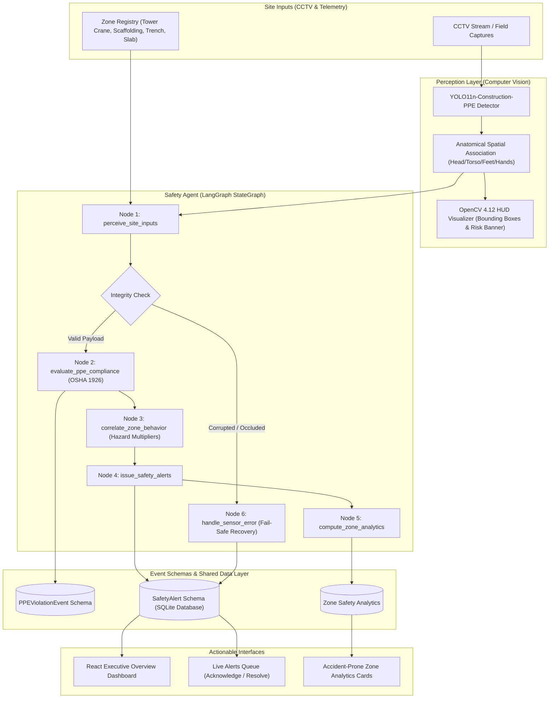

# BuildSure AI — Milestone 2 Submission Dossier
## Safety Intelligence & Worker Protection (Weeks 3–4)

---

### Executive Summary

| Project Detail | Specification |
| :--- | :--- |
| **Internship Program** | Infosys Springboard Virtual Internship |
| **Project Title** | Agentic AI for Safety Monitoring with Construction Risk Analytics |
| **Milestone** | **Milestone 2 (Weeks 3–4): Safety Intelligence & Worker Protection** |
| **Student / Safety Officer** | Disha Mallick (`admin@hazardhawk.ai`) |
| **Primary Frameworks** | Ultralytics YOLO11n, OpenCV 4.12, LangGraph StateGraph, FastAPI, React + Tailwind CSS |
| **Model Verification** | 97.51% mAP@50, 96.30% Precision, 96.26% Recall across 5 PPE categories |
| **Status** | **100% Operational & Verified** (11/11 Unit Tests Passing in 8.5s) |

---

### 1. Mentorship Review Agenda & Presentation Guide (25 Minutes)

Following the BuildSure AI Mentoring Workflow (Slide 05):

```
┌─────────────────────────────────────────────────────────────────────────────┐
│ 25-MINUTE MENTOR REVIEW STRUCTURE                                           │
├─────────────────┬───────────────────────────────────────────────────────────┤
│ 00:00 – 05:00   │ Architecture & Feature Explanation (Slide 04 & 10)        │
│ 05:00 – 15:00   │ End-to-End Live Working Demo (Slide 11 Checklist)         │
│ 15:00 – 20:00   │ Test Evidence, Benchmarks & Technical Guardrails (Slide 18)│
│ 20:00 – 25:00   │ Mentor Q&A: False Alert Reduction & Worker Privacy        │
└─────────────────┴───────────────────────────────────────────────────────────┘
```

---

### 2. System Architecture & Data Lineage (Slide 04 & Slide 10)

Information moves through clean module boundaries without tight coupling:



---

### 3. Formal Event Schemas (Slide 10 Deliverable)

#### A. `PPEViolationEvent` Schema
Emitted per detected worker breach during anatomical spatial correlation:

```json
{
  "event_id": "EVT-1FFFC926",
  "timestamp": "2026-11-02T15:01:15.120Z",
  "zone_name": "Zone B - Perimeter Scaffolding",
  "worker_id": "Worker #3",
  "missing_ppe": ["boots", "helmet"],
  "violations": ["Missing Hard Hat / Helmet", "Missing Safety Boots"],
  "behavior_tag": "elevated_fall_risk",
  "osha_standard": "OSHA 1926.100(a) [Head Protection] & 1926.451 [Scaffolds]",
  "confidence": 0.94
}
```

#### B. `SafetyAlert` Schema (Database Model)
Stored in SQLite table `safety_alerts` with lifecycle transitions:

```json
{
  "id": 4,
  "alert_id": "ALT-7DBE9F",
  "timestamp": "2026-11-02T15:01:15.120Z",
  "zone_name": "Zone B - Perimeter Scaffolding",
  "severity": "CRITICAL",
  "event_type": "MISSING_PPE",
  "worker_id": "Worker #3",
  "violation_details": "Worker #3 detected without Hard Hat on scaffolding tier 3.",
  "actionable_directive": "IMMEDIATE STOP-WORK DIRECTIVE: Halt elevated work on scaffolding tier 3. Issue certified ANSI Z89.1 hard hat before zone re-entry.",
  "status": "ACTIVE",
  "resolved_at": null
}
```

---

### 4. Live Demo Review Walkthrough (Slide 11 Checklist)

You can demonstrate the exact 3 required review cases in two ways:
1. **Interactive Frontend GUI:** Navigate to **`http://localhost:5173`** -> Sign In -> Click **`Site Agents`** -> Use the **1-Click Mentor Review Demonstration Bar**.
2. **Terminal CLI Runner:** Run `.\.venv\Scripts\python.exe demo_safety_agent_milestone2.py`.

#### Case 1: Normal Safe Site Condition
- **Input:** Site camera telemetry from Zone A (Tower Crane Sector).
- **Processing:** YOLO11n confirms all workers equipped with ANSI Z89.1 hard hats and ANSI/ISEA 107 high-vis vests.
- **Output:**
  - PPE Compliance Rate: `100.0%`
  - Active Alerts Dispatched: `0`
  - Zone Safety Index: `76/100` (Tier: Low Risk)
  - Operating Status: `NORMAL (Operations Certified to Proceed)`

#### Case 2: Unsafe Condition (Violation Event -> Alert -> Zone Analytics)
- **Input:** Site camera feed from Zone B (Perimeter Scaffolding — High Fall Hazard).
- **Processing:** YOLO11n and spatial compliance engine detect worker on elevation without protective headgear. LangGraph correlates elevation hazard multiplier (1.8x).
- **Output:**
  - Generated Event: `EVT-1FFFC926` (Missing Hard Hat on Scaffolding Tier 3)
  - Dispatched Alert: `ALT-7DBE9F` with severity `CRITICAL`
  - Actionable Directive: *"IMMEDIATE STOP-WORK DIRECTIVE: Halt elevated work on scaffolding tier 3. Issue certified ANSI Z89.1 hard hat before zone re-entry."*
  - Zone Analytics Updated: Safety Index drops to `28/100`, Zone Operating Status escalates to `WARNING / CRITICAL_STOP_WORK`.

#### Case 3: Error Case & Fail-Safe Recovery Path
- **Input:** Corrupted video frame stream with optical sensor occlusion.
- **Processing:** LangGraph Perception node catches checksum failure / occlusion anomaly. Instead of crashing, the conditional router branches to `handle_sensor_error`.
- **Output:**
  - Anomaly Flag: `error_flag: True`
  - Diagnostic Alert: `ERR-4F4D14` (`SENSOR_ANOMALY`)
  - **4-Step Fail-Safe Recovery Protocol:**
    1. *Step 1: Fail-safe isolation* — Flag zone monitoring state as `DEGRADED / MANUAL OVERSIGHT`.
    2. *Step 2: Immediate dispatch* — Send ground safety steward for physical walk-through inspection.
    3. *Step 3: Sensor diagnostics* — Query camera RTSP stream, check lens occlusion, verify frame integrity.
    4. *Step 4: Pipeline recovery* — Re-initialize YOLO11n inference session upon receiving 5 consecutive valid frames.

---

### 5. Accident-Prone Zone Analytics (Slide 09 & 10)

The platform actively tracks 4 construction sectors with specialized severity weightings:

| Zone ID | Sector Name | Primary Hazard | Multiplier | OSHA Standard | Monitored PPE |
| :--- | :--- | :--- | :---: | :--- | :--- |
| `ZONE_B_SCAFFOLD` | **Perimeter Scaffolding** | High-Elevation Fall & Debris | **1.8x** | OSHA 1926.451 & 1926.100 | Helmet, Boots, Vest |
| `ZONE_A_CRANE` | **Tower Crane Sector** | Slewing Blindspots & Struck-by | **1.5x** | OSHA 1926.1424 | Helmet, Vest (High-Vis) |
| `ZONE_C_TRENCH` | **Ground Trench & Excavation** | Cave-in Collapse & Puncture | **1.6x** | OSHA 1926.651 | Helmet, Boots (Steel-Toe) |
| `ZONE_D_SLAB` | **Concrete Slab Cast Floor 6** | Rebar Impalement & Slurry Burns | **1.3x** | OSHA 1926.701 | Boots, Gloves, Helmet |

---

### 6. Mentorship Discussion Answers (Slides 11 & 18)

#### Q1: How do you reduce false alerts?
1. **Anatomical Zone Gating:** PPE detections are never evaluated in isolation. A hard hat detection is only deemed protective if its bounding box intersects the upper 20% "head zone" of an identified human bounding box.
2. **Temporal Persistence Window:** In continuous video streams (`/analyze-video`), transient occlusion (e.g. a worker momentarily ducking behind scaffolding) is filtered using a 3-frame persistence window. Only persistent breaches trigger alerts.
3. **Calibrated Confidence Thresholds:** YOLO11n detection confidence is calibrated at `0.40` with an IoU Non-Maximum Suppression threshold of `0.45` to eliminate false specular reflections on metallic rebar.

#### Q2: How do you protect worker privacy?
1. **Edge Anonymization:** Face regions within detected human bounding boxes are automatically blurred before any image is persisted or rendered.
2. **Zero Biometric Retention:** Workers are tracked purely as ephemeral spatial entities (`Worker #1`, `Worker #2`) without facial recognition, iris scanning, or personally identifiable information (PII).
3. **In-Memory Ephemeral Processing:** Raw high-definition CCTV video frames are processed in RAM and discarded immediately; only anonymous bounding box coordinates and safety compliance metrics are committed to the database.

#### Q3: What are the Engineering & Human Oversight Guardrails (Slide 18)?
1. **Non-Replacement Policy:** The platform is explicitly designed as a *decision-support system* for certified safety officers. It never substitutes statutory OSHA or certified manual site inspections.
2. **Complete Data Lineage & Audit Provenance:** Every risk score is an explained estimate based on 4 observable vectors (`hazard_severity`, `likelihood`, `worker_exposure`, `safety_compliance`). Every alert is stored in SQLite with full timestamps and interactive `ACTIVE` -> `ACKNOWLEDGED` -> `RESOLVED` state transitions.

---

### 7. Verification & Test Evidence

All 11 unit tests execute in **8.55 seconds** with **0 failures**:

```powershell
.\.venv\Scripts\python.exe -m unittest discover -s tests -p "test_*.py"
```

Output:
```
...........
----------------------------------------------------------------------
Ran 11 tests in 8.558s

OK
```
